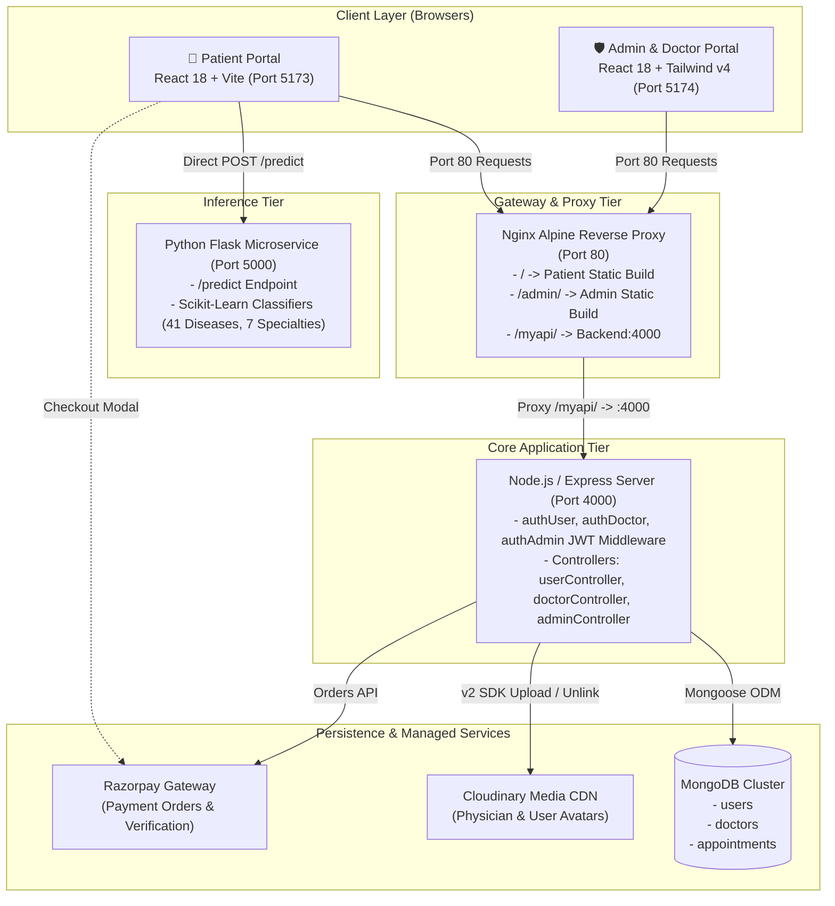
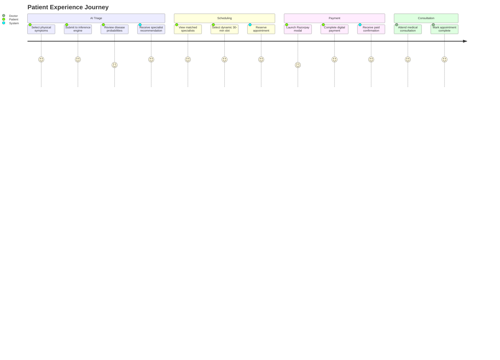
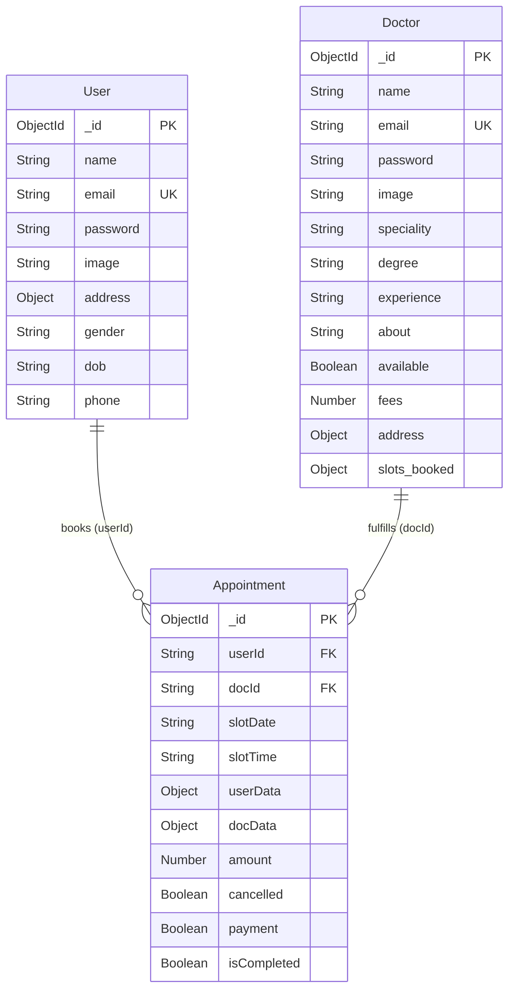
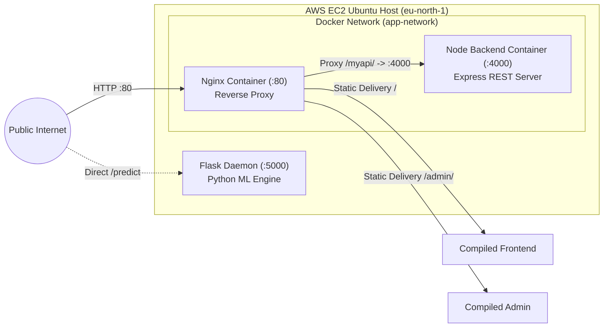

# 🏥 Prescripto — AI-Powered Healthcare Triage & Dynamic Appointment Scheduler

<div align="center">


<br>

> **An intelligent full-stack hospital management & patient scheduling platform combining machine-learning diagnostic triage, dynamic conflict-free calendar booking, role-based portals, and automated payment settlement.**

<br>

[🌐 Live Patient Portal](http://ec2-13-60-60-176.eu-north-1.compute.amazonaws.com/) • [🛡️ Live Admin/Doctor Panel](http://ec2-13-60-60-176.eu-north-1.compute.amazonaws.com/admin/index.html) • [🏗️ System Architecture Guide](docs/SYSTEM_ARCHITECTURE_AND_INTERVIEW_GUIDE.md) • [📘 Interview Q&A Reference](INTERVIEW_QA_REFERENCE.md)

</div>

---

## 📑 Table of Contents

- [Overview](#-overview)
  - [The Problem](#-the-problem)
  - [The Solution](#-the-solution)
- [Key Features](#-key-features)
  - [1. Patient Experience & AI Triage](#1-patient-experience--ai-triage)
  - [2. Physician Portal](#2-physician-portal)
  - [3. Hospital Administration](#3-hospital-administration)
  - [4. Financial & Payment Flow](#4-financial--payment-flow)
- [Visual Tour & Screenshots](#-visual-tour--screenshots)
  - [AI Diagnostic Triage & Clinical Urgency](#-ai-diagnostic-triage--clinical-urgency)
  - [Patient Booking & Discovery Workflow](#-patient-booking--discovery-workflow)
  - [Doctor Clinical Portal](#-doctor-clinical-portal)
  - [Hospital Administrative Command Center](#-hospital-administrative-command-center)
- [Technology Stack](#-technology-stack)
- [System Architecture](#-system-architecture)
- [Repository Structure](#-repository-structure)
- [Prerequisites](#-prerequisites)
- [Installation and Setup](#-installation-and-setup)
  - [Option A: Local Development Setup](#option-a-local-development-setup-step-by-step)
  - [Option B: Docker Compose Deployment](#option-b-docker-compose-deployment)
- [Environment Variables](#-environment-variables)
- [Running the Application](#-running-the-application)
- [End-to-End User Journey](#-end-to-end-user-journey)
- [API Reference Overview](#-api-reference-overview)
- [Database Schema & Data Model](#-database-schema--data-model)
- [Machine Learning & Diagnostic Engine](#-machine-learning--diagnostic-engine)
- [Testing & Quality Assurance](#-testing--quality-assurance)
- [Deployment Architecture](#-deployment-architecture)
- [Security & Privacy Audit](#-security--privacy-audit)
- [Troubleshooting & FAQ](#-troubleshooting--faq)
- [Known Limitations & Roadmap](#-known-limitations--roadmap)
- [Contributing](#-contributing)
- [License](#-license)

---

## 🌟 Overview

### 🧩 The Problem
Outpatient healthcare systems suffer from two major operational friction points:
1. **Specialist Misallocation:** Patients frequently misdiagnose their symptoms, scheduling consultations with incorrect medical specialists (e.g., booking an expensive cardiologist consultation for gastroesophageal reflux). This causes treatment delays, clinic overcrowding, and unnecessary referral cycles.
2. **Scheduling Inflexibility & Double-Booking:** Outdated clinic scheduling systems rely on static timesheets that are susceptible to double-booking, fail to prioritize acute medical emergencies, and lack real-time digital payment reconciliation.

### 💡 The Solution
**Prescripto** bridges pre-consultation diagnostic intelligence with hospital resource scheduling:
- **Pre-Consultation ML Triage:** Patients select their symptoms from a 132-symptom registry. A Scikit-Learn tree ensemble evaluates the clinical feature vector to predict the most probable pathology across 41 conditions and recommends the appropriate medical specialty.
- **Urgency Classification:** Diagnoses map to a 4-tier clinical severity hierarchy (`emergency`, `high`, `medium`, `low`). Life-threatening conditions (e.g., myocardial infarction, acute stroke) trigger an emergency protocol that bypasses multi-day waiting lists.
- **Dynamic Conflict-Free Allocation:** The calendar engine computes 30-minute consultation slots over a rolling 7-day window. Previously booked slots are automatically masked in real time with zero database bloat.
- **Multi-Role Separation:** Independent portals tailored for Patients, Doctors, and Hospital Administrators.

---

## ⚡ Key Features

### 1. Patient Experience & AI Triage
- **Supervised Symptom Classification:** Accepts multi-symptom inputs ($\ge 3$ symptoms) to generate differential diagnoses with probability confidence scores.
- **Specialty Matching:** Automatically directs patients to the corresponding department (`General physician`, `Gynecologist`, `Dermatologist`, `Pediatricians`, `Neurologist`, `Gastroenterologist`, `Cardiologist`).
- **Emergency Fast-Track:** Flags critical cases with high-visibility emergency action alerts and one-click access to on-call emergency physicians.
- **Dynamic 30-Minute Interval Booking:** Real-time slot rendering between 10:00 AM and 9:00 PM, accounting for the current time on the current day.
- **Account & History Hub:** Manage personal medical profile, emergency contacts, upcoming consultations, and past booking history.

### 2. Physician Portal
- **Consultation Schedule Roster:** Clean queue view of upcoming patient appointments with status filtering.
- **Consultation Lifecycle Management:** Mark appointments as fulfilled (`isCompleted: true`) or cancel with automatic patient notification and calendar release.
- **Availability Switch:** Real-time toggle to indicate on-duty or off-duty status across hospital directories.
- **Practice Analytics:** Live dashboard tracking gross consultation revenue, unique patient volume, and recent consultations.
- **Profile Customization:** Modify consultation fees, clinic address, and professional background.

### 3. Hospital Administration
- **Global Operations Command:** Audit and supervise facility-wide appointment traffic across all medical departments.
- **Physician Onboarding & Credentialing:** Register verified medical professionals with Cloudinary-backed credential photo ingestion.
- **Availability Override:** Facility-wide capability to toggle doctor active status.
- **Centralized Slot Invalidation:** Cancel appointments with automatic time-slot recovery back to the physician's schedule.

### 4. Financial & Payment Flow
- **Razorpay Digital Checkout:** Seamless online payment flow supporting UPI, debit/credit cards, and net banking.
- **Cash vs. Digital Tracking:** Clear audit tags (`ONLINE` vs `CASH`) on all doctor and administrative appointment sheets.

---

## 🖼️ Visual Tour & Screenshots

### 🧠 AI Diagnostic Triage & Clinical Urgency

| Symptom Selection & Analysis | Diagnostic Results & Specialist Recommendation |
| :---: | :---: |
|  |  |
| *Patients select from a structured 132-symptom registry with real-time tag management* | *ML output displaying primary condition, confidence percentage, top-3 differentials, and specialist recommendation* |

| Emergency Severity Trigger | Emergency Doctor Slot Allocation |
| :---: | :---: |
|  |  |
| *Automated severity detection prompts immediate emergency protocol when critical conditions are identified* | *One-click routing to verified emergency department on-call physician* |

---

### 👤 Patient Booking & Discovery Workflow

| Home Page & Specialty Discovery | Doctor Directory by Specialty |
| :---: | :---: |
|  |  |
| *Hero banner with quick-access specialty filter carousel and top physician highlights* | *Faceted physician catalog filtered by medical specialty* |

| Conflict-Free Slot Selection | My Appointments & Payment Status |
| :---: | :---: |
|  |  |
| *Dynamic 7-day 30-minute interval selection; already-booked slots are automatically hidden* | *Patient appointment roster with cancellation triggers and Razorpay payment status* |

| Razorpay Online Checkout | User Profile Management |
| :---: | :---: |
|  |  |
| *Direct gateway order generation and online transaction settlement* | *Personal metadata, date of birth, address lines, and avatar upload* |

---

### 🩺 Doctor Clinical Portal

| Doctor Authentication | Clinical Dashboard & Key Metrics |
| :---: | :---: |
|  |  |
| *Role-segregated login switchable between Doctor and Admin* | *Gross consultation earnings, unique patient counter, and recent bookings* |

| Doctor Appointments Queue | Doctor Profile & Availability Configuration |
| :---: | :---: |
|  |  |
| *Interactive appointment roster with Complete and Cancel fulfillment actions* | *Live fee management, clinic address configuration, and availability toggle* |

---

### 🛡️ Hospital Administrative Command Center

| Admin Central Dashboard | Hospital-Wide Appointment Control |
| :---: | :---: |
|  |  |
| *Global analytics aggregating total physicians, patients, and facility bookings* | *Comprehensive appointment audit table across all hospital departments* |

| Physician Registration & Onboarding | Doctor Availability Supervision |
| :---: | :---: |
|  |  |
| *Multi-part physician onboarding with Cloudinary-backed credential upload* | *Instant facility-wide doctor availability toggle switchboard* |

---

## 🛠️ Technology Stack

| Domain | Technology | Version | Description & Rationale |
| :--- | :--- | :--- | :--- |
| **Patient Client** | **React** | `^18.3.1` | Component-driven SPA with declarative UI rendering |
| **Frontend Tooling** | **Vite** | `^6.0.5` | Native ES-module bundling with sub-second HMR |
| **Styling (Front)** | **Tailwind CSS** | `^3.4.17` | Utility-first styling with custom health-tech color system |
| **Admin Client** | **React + Tailwind v4** | `Tailwind ^4.0.3` | Next-gen Vite-integrated Oxide engine for the admin dashboard |
| **Routing** | **React Router DOM** | `^7.1.3` / `^7.1.5` | Dynamic client-side routing with URL parameter extraction |
| **Backend API** | **Node.js + Express** | `express@^4.21.2` | Event-driven RESTful API gateway in native ES Modules (`type: module`) |
| **Database** | **MongoDB + Mongoose** | `mongoose@^8.9.6` | Document store handling dynamic nested slot maps and historical snapshots |
| **ML Microservice** | **Python 3 + Flask** | Flask 3.x | Lightweight microservice isolating CPU-intensive matrix math |
| **Model Framework** | **Scikit-Learn** | 1.x / NumPy / Pandas | Pre-trained Decision Tree / Random Forest classification pipelines |
| **Media CDN** | **Cloudinary** | `cloudinary@^2.5.1` | Automated image optimization, transformation, and CDN delivery |
| **Payment Gateway** | **Razorpay** | `razorpay@^2.9.5` | Digital payment orders, checkout modal, and verification API |
| **File Buffering** | **Multer** | `^1.4.5-lts.1` | Ephemeral disk buffering to `os.tmpdir()` with MIME/size filters |
| **Reverse Proxy** | **Nginx Alpine** | `alpine` | Port 80 edge reverse proxy routing `/`, `/admin/`, and `/myapi/` |
| **Containerization** | **Docker & Compose** | `docker-compose 3.8` | Container orchestration across frontend, admin, and backend |

---

## 🏗️ System Architecture



> 📖 **Deep Dive Available:** For a detailed breakdown including HLD/LLD diagrams, concurrency race condition analyses, and complete sequence diagrams, see [`docs/SYSTEM_ARCHITECTURE_AND_INTERVIEW_GUIDE.md`](docs/SYSTEM_ARCHITECTURE_AND_INTERVIEW_GUIDE.md).

---

## 📁 Repository Structure

```text
Prescripto-AI/
├── admin/                             # Admin & Doctor Portal (React 18, Tailwind v4, Vite)
│   ├── src/
│   │   ├── components/                # Navbar.jsx, Sidebar.jsx
│   │   ├── context/                   # AdminContext.jsx, DoctorContext.jsx, AppContext.jsx
│   │   ├── pages/
│   │   │   ├── Admin/                 # AddDoctor.jsx, AllAppointments.jsx, Dashboard.jsx, DoctorList.jsx
│   │   │   ├── Doctor/                # DoctorAppointments.jsx, DoctorDashboard.jsx, DoctorProfile.jsx
│   │   │   └── Login.jsx              # Unified role-switchable login view
│   │   ├── App.jsx                    # Route definitions & token authorization gate
│   │   └── index.css                  # Tailwind v4 theme variables
│   ├── .env.example                   # Admin client environment template
│   ├── package.json                   # Dependencies: @tailwindcss/vite, react-router-dom v7
│   └── vite.config.js                 # Port 5174, base: '/admin/'
│
├── backend/                           # Node.js + Express REST API Server
│   ├── config/
│   │   ├── cloudinary.js              # Cloudinary SDK setup & upload helper with unlink cleanup
│   │   └── mongodb.js                 # Mongoose connection bootstrap
│   ├── controllers/
│   │   ├── adminController.js         # Doctor onboarding, global appointment cancel, metrics
│   │   ├── doctorController.js        # Doctor authentication, fulfillment, profile, earnings
│   │   └── userController.js          # Patient registration, slot booking, Razorpay integration
│   ├── middlewares/
│   │   ├── authAdmin.js               # Admin authorization validator
│   │   ├── authDoctor.js              # Doctor JWT verification & docId injection
│   │   ├── authUser.js                # Patient JWT verification & userId injection
│   │   └── multer.js                  # Disk storage engine targeting os.tmpdir(), 5MB limit
│   ├── models/
│   │   ├── appointmentModel.js        # Schema with denormalized historical user/doctor snapshots
│   │   ├── doctorModel.js             # Doctor schema with slots_booked map and { minimize: false }
│   │   └── userModel.js               # Patient schema with profile fields & default avatar
│   ├── routes/
│   │   ├── adminRoute.js              # /api/admin/* endpoints
│   │   ├── doctorRoute.js             # /api/doctor/* endpoints
│   │   └── userRoute.js               # /api/user/* endpoints
│   ├── .env.example                   # Backend environment template
│   ├── dockerfile                     # Node 18 runtime Dockerfile
│   ├── package.json                   # Dependencies: express, mongoose, razorpay, bcrypt
│   └── server.js                      # Express entry point, CORS, routes mounting (Port 4000)
│
├── frontend/                          # Patient Web Application (React 18, Tailwind v3, Vite)
│   ├── src/
│   │   ├── assets/assets.js           # Static icons, doctor catalog fallback, specialty icons
│   │   ├── components/                # Banner, Footer, Header, Navbar, RelatedDoctors, TopDoctors
│   │   ├── context/AppContext.jsx     # Global patient state (token, doctors, backend_url, ml_url)
│   │   ├── pages/
│   │   │   ├── Appoinments.jsx        # Dynamic 7-day 30-min slot calculation & reservation
│   │   │   ├── Doctors.jsx            # Specialty filter sidebar & physician cards catalog
│   │   │   ├── Home.jsx               # Landing page aggregating Hero, Specialties, Top Doctors
│   │   │   ├── Login.jsx              # Patient registration & login forms
│   │   │   ├── MyAppoinments.jsx      # Appointment roster, Razorpay modal launcher, cancellation
│   │   │   ├── MyProfile.jsx          # Profile management & avatar upload
│   │   │   └── SpecialistPredication.jsx # 132-symptom selector, ML client, severity triage UI
│   │   ├── App.jsx                    # Route table & ReactToastify container
│   │   └── index.css                  # Tailwind directives & Outfit font import
│   ├── .env.example                   # Frontend environment template
│   ├── package.json                   # Dependencies: react-router-dom v7, axios, tailwindcss v3
│   └── vite.config.js                 # Port 5173
│
├── ML Modelss/                        # Python Machine Learning Microservice
│   ├── ML models/                     # Serialized Scikit-Learn Model Artifacts
│   │   ├── disease_prediction_model.pkl # Trained classifier mapping symptoms to 41 diseases
│   │   ├── label_encoder.pkl          # Label encoder mapping integers to 7 specialties
│   │   ├── model.pkl                  # Trained classifier mapping symptoms to specialists
│   │   ├── prognosis_encoder.pkl      # Label encoder mapping integers to 41 disease strings
│   │   └── symptom_columns.pkl        # Serialized ordered list of 132 feature column keys
│   └── app.py                         # Flask REST API serving POST /predict (Port 5000)
│
├── docs/
│   └── SYSTEM_ARCHITECTURE_AND_INTERVIEW_GUIDE.md # 20-section reverse-engineered architecture guide
├── nginx/
│   └── default.conf                   # Reverse proxy configuration for edge routing
├── ScreenShots/                       # Verified project screenshots
├── docker-compose.yml                 # Multi-container orchestration (webserver:80, backend:4000)
├── dockerfile                         # Multi-stage Docker build (Frontend + Admin + Nginx)
├── INTERVIEW_QA_REFERENCE.md          # 365+ Staff-Level Technical Interview Q&A guide
└── README.md                          # Primary project documentation
```

---

## ⚙️ Prerequisites

Before installing the project locally, ensure you have the following installed:

- **Node.js:** `v18.0.0` or higher (`v20.x` recommended)
- **npm:** `v9.x` or higher
- **Python:** `v3.10.x` or higher
- **MongoDB:** Active MongoDB Atlas URI or local instance (`v6.0+`)
- **Docker & Docker Compose:** *(Optional, for containerized execution)*
- **Third-Party Accounts:**
  - [Cloudinary](https://cloudinary.com/) (Free tier credentials for physician/user photo uploads)
  - [Razorpay](https://razorpay.com/) (Test mode API keys for appointment payments)

---

## 🚀 Installation and Setup

### Option A: Local Development Setup (Step-by-Step)

#### 1. Clone the Repository
```bash
git clone https://github.com/yash-shende99/Prescripto-AI.git
cd Prescripto-AI
```

#### 2. Configure Backend Service
```bash
cd backend
npm install
cp .env.example .env
# Open .env and populate your MongoDB URI, Cloudinary, Razorpay, and JWT secrets
```

#### 3. Set Up Python ML Microservice
In a new terminal window:
```bash
cd "ML Modelss"
python -m venv venv

# On Windows:
venv\Scripts\activate
# On macOS/Linux:
source venv/bin/activate

pip install flask flask-cors pandas numpy scikit-learn
python app.py
```
*The ML inference API will start on `http://localhost:5000`.*

#### 4. Configure & Start Patient Frontend
In a new terminal window:
```bash
cd frontend
npm install
cp .env.example .env
npm run dev
```
*The Patient Portal will be accessible at `http://localhost:5173`.*

#### 5. Configure & Start Admin / Doctor Portal
In a new terminal window:
```bash
cd admin
npm install
cp .env.example .env
npm run dev
```
*The Admin/Doctor Portal will be accessible at `http://localhost:5174`.*

#### 6. Start the Backend API Server
Return to your backend terminal:
```bash
cd backend
npm run server
```
*The Express API will boot on `http://localhost:4000`.*

---

### Option B: Docker Compose Deployment

The repository includes a production multi-stage Docker configuration that builds both frontends and mounts them behind an Nginx reverse proxy alongside the Express backend.

```bash
# From the repository root:
docker-compose up --build
```

- **Patient Web App:** `http://localhost/`
- **Admin & Doctor Portal:** `http://localhost/admin/`
- **Backend API:** `http://localhost/myapi/`

---

## 🔐 Environment Variables

### Backend Configuration (`backend/.env`)

| Variable | Required | Default / Example | Purpose |
| :--- | :---: | :--- | :--- |
| `PORT` | Optional | `4000` | Port on which the Express API server listens |
| `MONGODB_URL` | **Yes** | `mongodb+srv://...` | MongoDB connection URI string |
| `JWT_SECRET` | **Yes** | `your_jwt_secret` | Secret key used to sign and verify authentication tokens |
| `ADMIN_EMAIL` | **Yes** | `admin@prescripto.com` | Hardcoded master email for hospital administrator login |
| `ADMIN_PASSWORD` | **Yes** | `secure_admin_pass` | Hardcoded master password for hospital administrator login |
| `CLOUDINARY_NAME` | **Yes** | `your_cloud_name` | Cloudinary cloud account name |
| `CLOUDINARY_API_KEY` | **Yes** | `your_api_key` | Cloudinary public API key |
| `CLOUDINARY_API_SECRET` | **Yes** | `your_api_secret` | Cloudinary private API secret |
| `RAZORPAY_KEY_ID` | **Yes** | `rzp_test_...` | Razorpay public Key ID for order generation |
| `RAZORPAY_KEY_SECRET` | **Yes** | `your_secret_key` | Razorpay private secret key for backend verification |
| `CURRENCY` | Optional | `INR` | Default transaction currency sub-unit |

### Frontend Configuration (`frontend/.env`)

| Variable | Required | Default / Example | Purpose |
| :--- | :---: | :--- | :--- |
| `VITE_BACKEND_URL` | **Yes** | `http://localhost:4000` | Express backend base URL (or `/myapi` behind Nginx) |
| `VITE_ML_URL` | **Yes** | `http://localhost:5000` | Python Flask microservice base URL |
| `VITE_RAZORPAY_KEY_ID` | **Yes** | `rzp_test_...` | Razorpay publishable Key ID for client modal checkout |

### Admin Configuration (`admin/.env`)

| Variable | Required | Default / Example | Purpose |
| :--- | :---: | :--- | :--- |
| `VITE_BACKEND_URL` | **Yes** | `http://localhost:4000` | Express backend base URL (or `/myapi` behind Nginx) |

---

## 🏃 Running the Application

| Subsystem | Working Directory | Command | Port / URL |
| :--- | :--- | :--- | :--- |
| **Backend API** | `backend/` | `npm run server` *(dev)* or `npm start` | `http://localhost:4000` |
| **ML Inference Service** | `ML Modelss/` | `python app.py` | `http://localhost:5000` |
| **Patient Frontend** | `frontend/` | `npm run dev` | `http://localhost:5173` |
| **Admin & Doctor Portal** | `admin/` | `npm run dev` | `http://localhost:5174` |
| **Docker Compose Stack** | `./` (root) | `docker-compose up --build` | `http://localhost:80` |

---

## 🧭 End-to-End User Journey



1. **Symptom Triage:** The patient navigates to `/SpecialistRecommendation`, selects symptoms (e.g., *chest_pain, breathlessness, sweating*), and clicks **Analyze Symptoms**.
2. **Clinical Severity Evaluation:** The Flask ML model predicts the primary disease (*Heart Attack* at 89.2% confidence) and target specialty (*Cardiologist*). The frontend matches this against the severity matrix, triggering a high-priority **Emergency Action Banner**.
3. **Doctor Selection & Slot Booking:** The patient navigates to `/appoinment/:docId`. The scheduling algorithm projects available 30-minute intervals over a 7-day rolling window, hiding already-booked slots. The patient confirms their desired slot.
4. **Checkout Settlement:** In `/my-appoinments`, the patient clicks **Pay Online**. The backend generates a Razorpay order, the patient settles the fee via UPI/Cards, and the appointment status updates to **Paid**.
5. **Doctor Fulfillment:** The physician logs into `/admin`, views the consultation in their queue, and marks the appointment as **Completed** once the session concludes.

---

## 📡 API Reference Overview

Detailed endpoint contracts are documented in [`docs/SYSTEM_ARCHITECTURE_AND_INTERVIEW_GUIDE.md`](docs/SYSTEM_ARCHITECTURE_AND_INTERVIEW_GUIDE.md#9-api-design). Below is a summary:

### Patient Routes (`/api/user`)
- `POST /register` — Register a new patient account
- `POST /login` — Authenticate patient; returns 24-hour JWT
- `GET /get-profile` — Fetch patient profile metadata *(Auth: `token`)*
- `POST /update-profile` — Update address, demographics, and upload avatar *(Auth: `token`)*
- `POST /book-appointment` — Reserve consultation slot *(Auth: `token`)*
- `GET /appointments` — List patient's bookings *(Auth: `token`)*
- `POST /cancle-appointment` — Cancel appointment & recover doctor slot *(Auth: `token`)*
- `POST /appointment-payment` — Generate Razorpay payment order *(Auth: `token`)*
- `POST /verify-payment` — Verify Razorpay order settlement *(Auth: `token`)*

### Doctor Routes (`/api/doctor`)
- `GET /list` — Public directory of doctors minus sensitive fields
- `POST /login` — Doctor authentication; returns doctor JWT
- `GET /appointments` — List appointments assigned to doctor *(Auth: `dtoken`)*
- `POST /complete-appointment` — Mark consultation fulfilled *(Auth: `dtoken`)*
- `POST /cancle-appointment` — Cancel consultation & release slot *(Auth: `dtoken`)*
- `GET /dashboard` — Fetch doctor earnings & patient metrics *(Auth: `dtoken`)*
- `GET /profile` — Fetch physician profile details *(Auth: `dtoken`)*
- `POST /update-profile` — Update fees, address, and availability status *(Auth: `dtoken`)*

### Admin Routes (`/api/admin`)
- `POST /login` — Admin authentication against environment credentials
- `POST /add-doctor` — Onboard doctor with Cloudinary photo upload *(Auth: `atoken`)*
- `POST /all-doctors` — List all registered physicians for administrative review *(Auth: `atoken`)*
- `POST /change-availablity` — Toggle physician active availability *(Auth: `atoken`)*
- `GET /appointments` — Facility-wide audit of all patient appointments *(Auth: `atoken`)*
- `POST /cancle-appointment` — Administrative appointment cancellation *(Auth: `atoken`)*
- `GET /dashboard` — Global hospital metrics *(Auth: `atoken`)*

### Machine Learning Microservice (`/predict`)
- `POST http://localhost:5000/predict` — Vectorizes symptoms array and returns diagnostic predictions, confidence percentages, top-3 differential diagnoses, and target specialist.

---

## 🗄️ Database Schema & Data Model

Prescripto uses MongoDB with Mongoose ODM. Schemas are defined in `backend/models/`:



### Key Schema Design Decisions
- **`slots_booked` with `{ minimize: false }`:** In `doctorModel.js#L17`, `slots_booked` is an empty object `{}` by default. Setting `{ minimize: false }` prevents Mongoose from stripping empty objects, ensuring that newly onboarded doctors always have a valid dictionary to read from.
- **Immutable Snapshots:** `appointmentModel.js` stores frozen JSON copies of `userData` and `docData`. This ensures that subsequent fee modifications or address edits by the physician do not retroactively corrupt historical billing records.

---

## 🧠 Machine Learning & Diagnostic Engine

### Symptom Vectorization Pipeline
Located in `ML Modelss/app.py`:
1. **Input Normalization:** Patient-selected symptom strings are converted to lowercase snake_case: `symptom.lower().replace(' ', '_')`.
2. **Binary Feature Space:** A single-row DataFrame with 132 columns is initialized to 0 based on `symptom_columns.pkl`. Matched features are set to 1.
3. **Probability Inference:**
   - Disease probabilities are generated via `disease_model.predict_proba(input_df)`.
   - The primary diagnosis is selected via `np.max()`.
   - The top-3 differential diagnoses are extracted using `np.argsort()[-3:][::-1]`.
   - The corresponding medical specialist is determined by `specialist_model.predict(input_df)`.

### Clinical Severity Mapping
The diagnostic prediction maps to a 4-tier clinical severity hierarchy:
- 🚨 **Emergency:** Conditions like *Heart attack* and *Paralysis (brain hemorrhage)* trigger an immediate emergency alert banner and route directly to emergency on-call physicians.
- ⚠️ **High Severity:** Conditions like *Pneumonia, Malaria, Dengue, and Tuberculosis* trigger urgent consultation booking recommendations.
- ℹ️ **Medium Severity:** Conditions like *Diabetes, Peptic ulcer, and Hypertension* recommend standard specialist consultations.
- ✅ **Low Severity:** Self-limiting conditions like *Common Cold, Allergies, and Migraine* route to general outpatient clinics.

---

## 🧪 Testing & Quality Assurance

- **Current Implementation:** Automated unit/integration test suites are **currently not implemented** in the repository (`package.json` contains `"test": "echo \"Error: no test specified\" && exit 1"`).
- **Manual Verification:** All endpoints, token headers, slot algorithms, and ML predictions have been verified via end-to-end browser walkthroughs and REST client testing.
- **Recommended Test Stack for Contributors:**
  - **Backend:** Jest + Supertest for REST API integration tests.
  - **ML Service:** Pytest for feature vectorization and probability output bounds testing.
  - **Frontend:** Vitest + React Testing Library for component rendering and slot generation validation.

---

## 🚢 Deployment Architecture



- **Live Deployment:** Deployed on an AWS EC2 instance (`eu-north-1` Stockholm region).
- **Containerization:** The root `dockerfile` builds the patient frontend and admin portal in multi-stage Node 20 environments, copying the compiled production assets into an Nginx Alpine runtime image.
- **Reverse Proxy Routing:** `nginx/default.conf` serves the patient app at `/`, the admin panel at `/admin/`, and proxies backend API traffic under `/myapi/` to `backend:4000`.

---

## 🔒 Security & Privacy Audit

| Security Domain | Implementation Details | Status / Recommendations |
| :--- | :--- | :--- |
| **Password Storage** | Bcrypt with salt work factor of 10 (`bcrypt.genSalt(10)`) | ✅ Industry-standard protection |
| **Token Authentication** | Role-segregated JWTs passed via `token`, `dtoken`, and `atoken` headers | ✅ Prevents cross-role privilege escalation |
| **Object-Level Access** | `userId` and `docId` verified before cancellations or completions | ✅ Protects against horizontal IDOR attacks |
| **File Upload Filter** | Multer restricts file size to 5MB and accepts only JPEG/PNG MIME types | ✅ Mitigates malicious executable uploads |
| **Disk Cleanup** | `fs.unlinkSync` cleans up ephemeral files in both success and error paths | ✅ Prevents local disk exhaustion |
| **Admin Secret Token** | Encodes `ADMIN_EMAIL + ADMIN_PASSWORD` in the plaintext JWT payload | ⚠️ **Recommended Fix:** Store `{ role: 'admin' }` claims instead |
| **Payment Verification** | Fetches order status from Razorpay but omits HMAC-SHA256 signature check | ⚠️ **Recommended Fix:** Add `crypto.createHmac` signature validation |

---

## ❓ Troubleshooting & FAQ

<details>
<summary><b>1. Error: <code>Cannot read properties of undefined (reading '16_10_2026')</code> during booking</b></summary>
<br>
<b>Cause:</b> The doctor document was created without the <code>slots_booked</code> map or the Mongoose model stripped the empty object on save.<br>
<b>Fix:</b> Verify that <code>{ minimize: false }</code> is present on the <code>doctorSchema</code> in <code>backend/models/doctorModel.js</code>. Ensure newly added doctors have <code>slots_booked: {}</code> initialized.
</details>

<details>
<summary><b>2. Why are the Patient App and Admin Panel on different ports locally?</b></summary>
<br>
<b>Explanation:</b> Both frontends are independent Vite applications. <code>frontend/vite.config.js</code> runs on port <code>5173</code>, while <code>admin/vite.config.js</code> runs on port <code>5174</code> to prevent local port collisions. In production, both are compiled into static assets served on unified port <code>80</code> via Nginx.
</details>

<details>
<summary><b>3. ML Microservice throws <code>FileNotFoundError: ML models/disease_prediction_model.pkl</code></b></summary>
<br>
<b>Cause:</b> The Flask app was started from a directory other than <code>ML Modelss/</code>.<br>
<b>Fix:</b> Change your working directory to <code>ML Modelss/</code> before running <code>python app.py</code> so that relative paths to the <code>ML models/</code> directory resolve correctly.
</details>

<details>
<summary><b>4. Razorpay checkout modal fails to open</b></summary>
<br>
<b>Cause:</b> Missing or invalid <code>VITE_RAZORPAY_KEY_ID</code> in <code>frontend/.env</code>, or Razorpay checkout script failed to load from CDN.<br>
<b>Fix:</b> Confirm that <code>VITE_RAZORPAY_KEY_ID</code> matches your Razorpay Test Key ID and verify that <code>frontend/index.html</code> includes the Razorpay script tag.
</details>

---

## 🗺️ Known Limitations & Roadmap

### Known Limitations
- **Single-Threaded Slot Mutation:** Slot booking uses an application-level read-modify-write cycle. Under high concurrency, simultaneous requests for the exact same slot could result in double-booking. (See [Architecture Guide](docs/SYSTEM_ARCHITECTURE_AND_INTERVIEW_GUIDE.md#13-performance-and-scalability) for the atomic `$addToSet` fix).
- **Synchronous Upload Processing:** Physician photo uploads are processed synchronously within the HTTP request cycle rather than being offloaded to an asynchronous background worker.

### Future Roadmap
- [ ] **Atomic Slot Reservation:** Refactor booking logic to use MongoDB `$addToSet` conditional operators.
- [ ] **Automated Test Coverage:** Implement comprehensive unit and integration test suites using Jest, Supertest, and Vitest.
- [ ] **HMAC Payment Signature Verification:** Implement cryptographic HMAC-SHA256 signature verification for Razorpay payment callbacks.
- [ ] **Multi-Facility Tenancy:** Expand schema support to manage multiple hospital branches under a single administrative umbrella.
- [ ] **Telemedicine Video Consultations:** Integrate WebRTC video rooms for direct remote doctor-patient consultations.

---

## 🤝 Contributing

Contributions are welcome! Please follow these guidelines:

1. **Fork the Repository:** Create your own fork of the project.
2. **Create a Feature Branch:**
   ```bash
   git checkout -b feature/atomic-slot-booking
   ```
3. **Commit Your Changes:** Write descriptive, structured commit messages following conventional commits:
   ```bash
   git commit -m "feat(booking): implement atomic slot updates using addToSet"
   ```
4. **Push to Your Branch:**
   ```bash
   git push origin feature/atomic-slot-booking
   ```
5. **Open a Pull Request:** Submit a PR detailing your changes, testing methodology, and any breaking schema modifications.

---

## 📜 License

The backend codebase declares an **ISC License** in `backend/package.json`. Root repository licensing is unspecified; all other rights remain reserved by the project author.

---

## 👨‍💻 Project Maintainer

- **Developer:** [Yash Shende](https://github.com/yash-shende99)
- **Live Demo (Patient):** [Launch User Dashboard](http://ec2-13-60-60-176.eu-north-1.compute.amazonaws.com/)
- **Live Demo (Admin):** [Launch Admin Panel](http://ec2-13-60-60-176.eu-north-1.compute.amazonaws.com/admin/index.html)
- **Architecture Documentation:** [`docs/SYSTEM_ARCHITECTURE_AND_INTERVIEW_GUIDE.md`](docs/SYSTEM_ARCHITECTURE_AND_INTERVIEW_GUIDE.md)
- **Technical Interview Q&A Reference:** [`INTERVIEW_QA_REFERENCE.md`](INTERVIEW_QA_REFERENCE.md)
