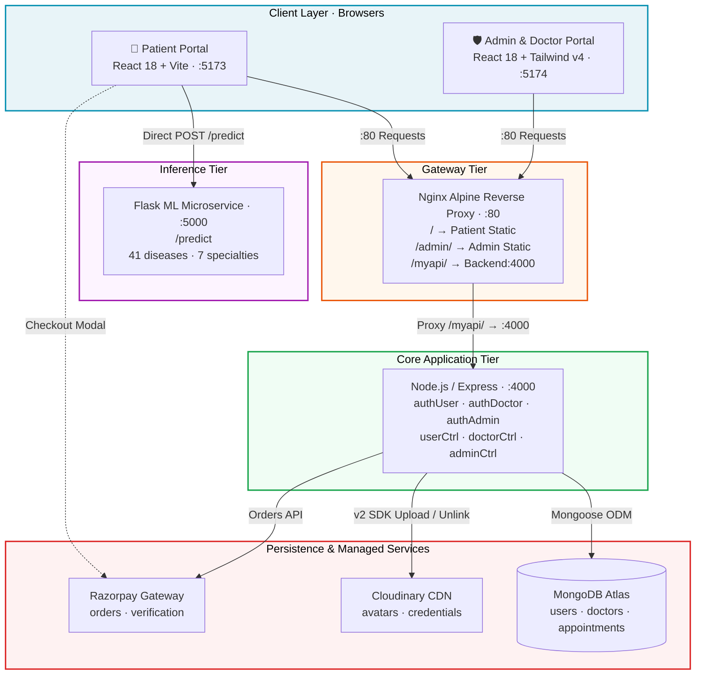
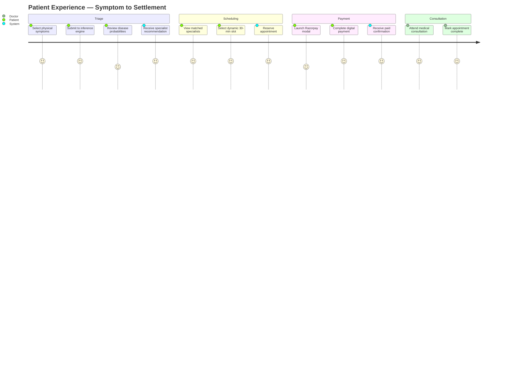
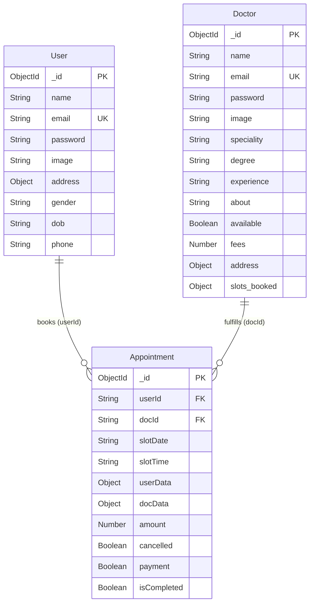

<!-- ═══════════════════════════════════════════════════════════════════════════
     PRESCRIPTO · Clinical Dossier
     AI Triage · Dynamic Scheduling · Multi-Portal Healthcare Platform
     ═══════════════════════════════════════════════════════════════════════════ -->

<div align="center">

```
   ╭─────────────────────────────────────────────────────────────────╮
   │  ♥  HR: 72 bpm    SpO₂: 98%    BP: 120/80    TEMP: 98.6°F    ✚  │
   ╰─────────────────────────────────────────────────────────────────╯
     ─╱╲──╱╲───╱╲────╱╲──╱╲───╱╲──╱╲────╱╲──╱╲───╱╲────╱╲──╱╲──╱╲─
```

# ✚ PRESCRIPTO

### AI-Powered Healthcare Triage & Dynamic Appointment Scheduler

<sub><b>Chief Complaint:</b> Outpatient systems misroute patients · double-book slots · lose revenue</sub><br>
<sub><b>Attending:</b> Full-stack ML + multi-role portal platform · <b>Status:</b> 🟢 Deployed & Live</sub>

<br>

[](https://nodejs.org/)
[](https://expressjs.com/)
[](https://react.dev/)
[](https://vitejs.dev/)
[](https://www.python.org/)
[](https://flask.palletsprojects.com/)
[](https://scikit-learn.org/)
[](https://www.mongodb.com/)
[](https://www.docker.com/)
[](https://nginx.org/)

<br>

<kbd>[ 🌐 Live Patient Portal ]</kbd> · <kbd>[ 🛡️ Admin & Doctor Panel ]</kbd> · <kbd>[ 🏗️ Architecture Guide ](docs/SYSTEM_ARCHITECTURE_AND_INTERVIEW_GUIDE.md)</kbd> · <kbd>[ 📘 Interview Q&A ](INTERVIEW_QA_REFERENCE.md)</kbd>

<a href="http://ec2-13-60-60-176.eu-north-1.compute.amazonaws.com/"><b>▶ Patient Demo</b></a> &nbsp;·&nbsp; <a href="http://ec2-13-60-60-176.eu-north-1.compute.amazonaws.com/admin/index.html"><b>▶ Admin / Doctor Demo</b></a>

</div>

---

<div align="center">

```
  ┌────────────────────────────────────────────────────────────────────┐
  │                                                                    │
  │    🩺  TRIAGE  →  📅  SCHEDULE  →  💳  PAY  →  🩻  CONSULT         │
  │                                                                    │
  │    Symptom          30-min           Razorpay        Doctor        │
  │    intake           slots            checkout        fulfills      │
  │                                                                    │
  └────────────────────────────────────────────────────────────────────┘
```

</div>

---

## 📋 Chart of Contents

<table>
<tr>
<td valign="top" width="33%">

**🩺 CLINICAL**
- [Chief Complaint](#-chief-complaint)
- [Diagnosis](#-diagnosis)
- [Treatment Plan](#-treatment-plan)
- [Vital Signs](#-vital-signs)

**🖼️ IMAGING**
- [Clinical Imaging](#-clinical-imaging)

</td>
<td valign="top" width="33%">

**🔬 SYSTEMS**
- [Anatomy](#-anatomy)
- [Floor Plan](#-floor-plan)
- [Chart of Records](#-chart-of-records)
- [Neurology](#-neurology-ml-engine)

**💉 PROCEDURES**
- [Pre-Op Checklist](#-pre-op-checklist)
- [Intake Procedure](#-intake-procedure)
- [Code Blue](#-code-blue)

</td>
<td valign="top" width="33%">

**🚑 OPERATIONS**
- [Controlled Substances](#-controlled-substances)
- [Patient Pathway](#-patient-pathway)
- [Orders](#-orders)
- [Medical Records](#-medical-records)

**🛡️ GOVERNANCE**
- [Infection Control](#-infection-control)
- [Side Effects](#-side-effects)
- [Follow-Up](#-follow-up)

</td>
</tr>
</table>

---

<a id="chief-complaint"></a>
## 🩺 Chief Complaint

> *Outpatient intake is a bottleneck. Two failures dominate:*

```
   ┌─────────────────────────────────┐    ┌─────────────────────────────────┐
   │  ⚠️  SPECIALIST MISALLOCATION   │    │  ⚠️  SCHEDULING CHAOS           │
   ├─────────────────────────────────┤    ├─────────────────────────────────┤
   │                                 │    │                                 │
   │  Patients misdiagnose their     │    │  Static timesheets are prone    │
   │  own symptoms → book the        │    │  to double-booking, ignore      │
   │  wrong specialist (cardio       │    │  acute emergencies, and lack    │
   │  consult for acid reflux).      │    │  real-time payment reconciliation│
   │                                 │    │                                 │
   │  ⟶  Delayed treatment           │    │  ⟶  Lost revenue                │
   │  ⟶  Clinic overcrowding         │    │  ⟶  Patient frustration         │
   │  ⟶  Referral loops              │    │  ⟶  Zero urgency prioritization │
   │                                 │    │                                 │
   └─────────────────────────────────┘    └─────────────────────────────────┘
```

---

<a id="diagnosis"></a>
## 🔬 Diagnosis

**Prescripto bridges two broken layers** — pre-consultation intelligence and resource scheduling — into one continuous clinical workflow.

<table>
<tr>
<td width="50%" valign="top">

#### 🧠 Pre-Consultation ML Triage

```
  ┌─ Symptom Intake ──────────────┐
  │  132-symptom registry          │
  │  Multi-select (≥ 3)            │
  └────────────┬───────────────────┘
               │
               ▼
  ┌─ Feature Vector ──────────────┐
  │  132-dim binary encoding       │
  └────────────┬───────────────────┘
               │
               ▼
  ┌─ Scikit-Learn Ensemble ───────┐
  │  Predicts across 41 conditions │
  │  + confidence percentages      │
  │  + top-3 differentials         │
  └────────────┬───────────────────┘
               │
               ▼
  ┌─ Specialty Router ────────────┐
  │  → Cardiologist                │
  │  → Neurologist                 │
  │  → Gastroenterologist          │
  │  → Dermatologist / etc.        │
  └────────────────────────────────┘
```

</td>
<td width="50%" valign="top">

#### 🚨 4-Tier Clinical Severity

```
  ┌──────┬────────────────────────────────────┐
  │ 🚨   │ EMERGENCY                          │
  │      │ MI · Stroke                        │
  │      │ → bypass waitlist · on-call ping   │
  ├──────┼────────────────────────────────────┤
  │ ⚠️   │ HIGH                               │
  │      │ Pneumonia · Malaria · Dengue · TB  │
  │      │ → urgent consultation recommend    │
  ├──────┼────────────────────────────────────┤
  │ ℹ️   │ MEDIUM                             │
  │      │ Diabetes · Ulcer · Hypertension    │
  │      │ → standard specialist slot         │
  ├──────┼────────────────────────────────────┤
  │ ✅   │ LOW                                │
  │      │ Cold · Allergies · Migraine        │
  │      │ → general OPD                      │
  └──────┴────────────────────────────────────┘
```

</td>
</tr>
</table>

---

<a id="treatment-plan"></a>
## 💊 Treatment Plan

```
   Rx  PRESCRIPTO / once-daily / as-needed
   ─────────────────────────────────────────────────────────────────────

   ①  ML TRIAGE             Patient enters symptoms → ML predicts disease
                            + specialty + urgency tier

   ②  DYNAMIC SCHEDULING    30-min slots over 7-day rolling window
                            Booked slots masked in real-time

   ③  ROLE PORTALS          Patient · Doctor · Admin — separate UI/UX
                            Independent JWT scopes · RBAC enforced

   ④  PAYMENT SETTLEMENT    Razorpay gateway · UPI / Card / NetBanking
                            Cash vs. Online audit tags

   ⑤  CONSULTATION          Doctor marks complete · slot released
                            Immutable billing snapshot preserved
```

---

<a id="vital-signs"></a>
## 🫀 Vital Signs

> The four systems keeping Prescripto alive.

<table>
<tr>
<td width="50%" valign="top">

### ① Patient Experience & AI Triage

```
  ┌──────────────────────────────────────┐
  │  🧠 Supervised Symptom Classifier     │
  │     ≥ 3 symptoms → differential Dx    │
  │     + probability confidence scores   │
  └──────────────────────────────────────┘

  ┌──────────────────────────────────────┐
  │  🎯 Specialty Router                  │
  │     General · Gynae · Derm · Peds     │
  │     Neuro · Gastro · Cardio           │
  └──────────────────────────────────────┘

  ┌──────────────────────────────────────┐
  │  🚨 Emergency Fast-Track              │
  │     Auto-flag critical cases          │
  │     1-click on-call physician         │
  └──────────────────────────────────────┘

  ┌──────────────────────────────────────┐
  │  📅 Dynamic 30-min Interval Booking   │
  │     10:00 → 21:00 · 7-day window      │
  │     Real-time booked-slot masking     │
  └──────────────────────────────────────┘

  ┌──────────────────────────────────────┐
  │  👤 Account & History Hub             │
  │     Profile · Emergency contacts      │
  │     Upcoming + past bookings          │
  └──────────────────────────────────────┘
```

</td>
<td width="50%" valign="top">

### ② Physician Portal

```
  ┌──────────────────────────────────────┐
  │  📋 Consultation Roster               │
  │     Queue view · status filters       │
  └──────────────────────────────────────┘

  ┌──────────────────────────────────────┐
  │  ✅ Lifecycle Management              │
  │     Mark fulfilled / cancel           │
  │     Auto-notify patient · release slot│
  └──────────────────────────────────────┘

  ┌──────────────────────────────────────┐
  │  🔘 Availability Toggle               │
  │     On-duty · Off-duty · facility-wide│
  └──────────────────────────────────────┘

  ┌──────────────────────────────────────┐
  │  📊 Practice Analytics                │
  │     Gross revenue · unique patients   │
  │     recent consultation feed          │
  └──────────────────────────────────────┘

  ┌──────────────────────────────────────┐
  │  ⚙️ Profile Customization             │
  │     Fees · clinic address · bio       │
  └──────────────────────────────────────┘
```

</td>
</tr>
<tr>
<td width="50%" valign="top">

### ③ Hospital Administration

```
  ┌──────────────────────────────────────┐
  │  🎛️ Global Operations Command         │
  │     Facility-wide appointment audit   │
  │     Department traffic heatmap        │
  └──────────────────────────────────────┘

  ┌──────────────────────────────────────┐
  │  🩺 Physician Onboarding              │
  │     Cloudinary credential ingestion   │
  │     Multi-part registration form      │
  └──────────────────────────────────────┘

  ┌──────────────────────────────────────┐
  │  🔀 Availability Override             │
  │     Facility-wide on/off switches     │
  └──────────────────────────────────────┘

  ┌──────────────────────────────────────┐
  │  ❌ Centralized Slot Invalidation     │
  │     Cancel → auto-release to doctor   │
  └──────────────────────────────────────┘
```

</td>
<td width="50%" valign="top">

### ④ Financial & Payment Flow

```
  ┌──────────────────────────────────────┐
  │  💳 Razorpay Digital Checkout         │
  │     UPI · Debit/Credit · NetBanking   │
  └──────────────────────────────────────┘

  ┌──────────────────────────────────────┐
  │  💵 Cash vs. Digital Tracking         │
  │     ONLINE / CASH audit tags          │
  │     Doctor + admin sheets             │
  └──────────────────────────────────────┘

  ┌──────────────────────────────────────┐
  │  🔐 Order Generation + Verification   │
  │     Backend order create              │
  │     Settlement check                  │
  └──────────────────────────────────────┘
```

</td>
</tr>
</table>

---

<a id="clinical-imaging"></a>
## 🖼️ Clinical Imaging

> *Scans and observations from the deployed system.*

### 🧠 AI Diagnostic Triage

<table>
<tr>
<td align="center" width="50%">

**🧾 Symptom Intake**


<sub>Structured 132-symptom registry with real-time tag management</sub>

</td>
<td align="center" width="50%">

**🔬 Diagnostic Output**


<sub>Primary Dx · confidence % · top-3 differentials · specialist recommendation</sub>

</td>
</tr>
<tr>
<td align="center" width="50%">

**🚨 Emergency Severity Trigger**


<sub>Critical condition → high-visibility emergency protocol</sub>

</td>
<td align="center" width="50%">

**🚑 Emergency Slot Allocation**


<sub>One-click routing to verified on-call emergency physician</sub>

</td>
</tr>
</table>

---

### 👤 Patient Booking Workflow

<table>
<tr>
<td align="center" width="50%">

**🏠 Home & Specialty Discovery**


<sub>Hero banner · specialty carousel · top physician highlights</sub>

</td>
<td align="center" width="50%">

**🔍 Physician Directory**


<sub>Faceted catalog filtered by medical specialty</sub>

</td>
</tr>
<tr>
<td align="center" width="50%">

**📅 Conflict-Free Slot Selection**


<sub>7-day · 30-min slots · booked slots auto-hidden</sub>

</td>
<td align="center" width="50%">

**📋 My Appointments**


<sub>Roster with cancellation + Razorpay payment status</sub>

</td>
</tr>
<tr>
<td align="center" width="50%">

**💳 Razorpay Checkout**


<sub>Gateway order generation + online transaction settlement</sub>

</td>
<td align="center" width="50%">

**👤 Profile Management**


<sub>Personal metadata · DOB · address · avatar upload</sub>

</td>
</tr>
</table>

---

### 🩺 Physician Clinical Portal

<table>
<tr>
<td align="center" width="50%">

**🔐 Doctor Authentication**


<sub>Role-segregated login (Doctor / Admin switch)</sub>

</td>
<td align="center" width="50%">

**📊 Clinical Dashboard**


<sub>Gross earnings · unique patient count · recent bookings</sub>

</td>
</tr>
<tr>
<td align="center" width="50%">

**📋 Appointments Queue**


<sub>Interactive roster with Complete / Cancel actions</sub>

</td>
<td align="center" width="50%">

**⚙️ Profile & Availability**


<sub>Live fee management · clinic address · availability toggle</sub>

</td>
</tr>
</table>

---

### 🛡️ Hospital Administrative Command

<table>
<tr>
<td align="center" width="50%">

**🎛️ Central Dashboard**


<sub>Global analytics — physicians, patients, facility bookings</sub>

</td>
<td align="center" width="50%">

**🗂️ All Appointments Audit**


<sub>Comprehensive appointment table across all departments</sub>

</td>
</tr>
<tr>
<td align="center" width="50%">

**🩺 Physician Onboarding**


<sub>Multi-part registration with Cloudinary credential upload</sub>

</td>
<td align="center" width="50%">

**🔀 Availability Supervision**


<sub>Instant facility-wide on/off switchboard</sub>

</td>
</tr>
</table>

---

<a id="anatomy"></a>
## 🧬 Anatomy

> *Layered stack with rationale.*

<table>
<tr>
<td width="50%" valign="top">

**🎨 Frontend Layer**

| Tissue | Tech | Purpose |
|:---|:---|:---|
| Patient SPA | React `^18.3.1` | Component-driven UI |
| Admin SPA | React `^18.3.1` + Tailwind v4 | Separate operations console |
| Build | Vite `^6.0.5` | Sub-second HMR |
| Styling | Tailwind `^3.4.17` / `^4.0.3` | Utility-first healthcare palette |
| Routing | React Router DOM `^7.1.x` | Dynamic param routes |

</td>
<td width="50%" valign="top">

**⚙️ Backend Layer**

| Tissue | Tech | Purpose |
|:---|:---|:---|
| Runtime | Node.js `18+` | Native ESM |
| Framework | Express `^4.21.2` | Event-driven REST |
| ODM | Mongoose `^8.9.6` | Document store + schema validators |
| Auth | JWT · bcrypt `genSalt(10)` | Role-scoped tokens |
| Uploads | Multer `^1.4.5-lts.1` | 5 MB cap · JPEG/PNG MIME filter |
| Media | Cloudinary `^2.5.1` | Avatar + credential CDN |
| Payments | Razorpay `^2.9.5` | Order create + verify |

</td>
</tr>
<tr>
<td width="50%" valign="top">

**🧠 ML Microservice Layer**

| Tissue | Tech | Purpose |
|:---|:---|:---|
| Runtime | Python `3.10+` | Isolates CPU-heavy math |
| Server | Flask `3.x` | `/predict` REST endpoint |
| Model | Scikit-Learn `1.x` | Tree ensembles |
| Data | NumPy · Pandas | Vectorization + DataFrame ops |
| Artifacts | `.pkl` (5 serialized) | Model · encoders · symptom columns |

</td>
<td width="50%" valign="top">

**🏗️ Infrastructure Layer**

| Tissue | Tech | Purpose |
|:---|:---|:---|
| Reverse proxy | Nginx Alpine | Edge routing `/`, `/admin/`, `/myapi/` |
| Container | Docker + Compose `3.8` | Multi-stage builds |
| Host | AWS EC2 (`eu-north-1`) | Stockholm region |
| Persistence | MongoDB Atlas | Multi-region HA cluster |

</td>
</tr>
</table>

---

<a id="floor-plan"></a>
## 🏥 Floor Plan



> 📖 **Deep dive:** [`docs/SYSTEM_ARCHITECTURE_AND_INTERVIEW_GUIDE.md`](docs/SYSTEM_ARCHITECTURE_AND_INTERVIEW_GUIDE.md) — HLD/LLD, race-condition analyses, sequence diagrams.

---

<a id="chart-of-records"></a>
## 📁 Chart of Records

```text
Prescripto-AI/
│
├── 🏥 admin/                            ── Admin & Doctor Portal ──
│   ├── src/
│   │   ├── components/                  Navbar · Sidebar
│   │   ├── context/                     AdminContext · DoctorContext · AppContext
│   │   ├── pages/
│   │   │   ├── Admin/                   AddDoctor · AllAppointments · Dashboard · DoctorList
│   │   │   ├── Doctor/                  DoctorAppointments · DoctorDashboard · DoctorProfile
│   │   │   └── Login.jsx                Role-switchable login view
│   │   ├── App.jsx                      Routes + token gate
│   │   └── index.css                    Tailwind v4 theme vars
│   ├── .env.example
│   └── vite.config.js                   :5174 · base '/admin/'
│
├── ⚙️ backend/                          ── Node.js + Express REST API ──
│   ├── config/
│   │   ├── cloudinary.js                SDK setup + unlink cleanup
│   │   └── mongodb.js                   Connection bootstrap
│   ├── controllers/
│   │   ├── adminController.js           Onboarding · cancel · metrics
│   │   ├── doctorController.js          Auth · fulfillment · earnings
│   │   └── userController.js            Registration · booking · Razorpay
│   ├── middlewares/
│   │   ├── authAdmin.js
│   │   ├── authDoctor.js
│   │   ├── authUser.js
│   │   └── multer.js                    Disk → os.tmpdir() · 5 MB cap
│   ├── models/
│   │   ├── appointmentModel.js          Denormalized user/doctor snapshots
│   │   ├── doctorModel.js               slots_booked · { minimize: false }
│   │   └── userModel.js                 Profile + default avatar
│   ├── routes/                          adminRoute · doctorRoute · userRoute
│   ├── dockerfile                       Node 18 runtime
│   └── server.js                        Entry · CORS · routes · :4000
│
├── 🩺 frontend/                         ── Patient Web Application ──
│   ├── src/
│   │   ├── assets/assets.js             Icons · fallback catalog
│   │   ├── components/                  Banner · Footer · Header · Navbar · etc.
│   │   ├── context/AppContext.jsx       token · doctors · backend_url · ml_url
│   │   ├── pages/
│   │   │   ├── Appoinments.jsx          Dynamic 7-day slot calc + reserve
│   │   │   ├── Doctors.jsx              Specialty filter + physician cards
│   │   │   ├── Home.jsx                 Landing aggregator
│   │   │   ├── Login.jsx                Register + login
│   │   │   ├── MyAppoinments.jsx        Roster + Razorpay + cancel
│   │   │   ├── MyProfile.jsx            Profile + avatar upload
│   │   │   └── SpecialistPredication.jsx 132-symptom → ML → severity UI
│   │   ├── App.jsx                      Routes + ReactToastify
│   │   └── index.css                    Tailwind + Outfit font
│   └── vite.config.js                   :5173
│
├── 🧠 ML Modelss/                       ── Python ML Microservice ──
│   ├── ML models/
│   │   ├── disease_prediction_model.pkl  Symptoms → 41 diseases
│   │   ├── label_encoder.pkl             Integers → 7 specialties
│   │   ├── model.pkl                     Symptoms → specialist
│   │   ├── prognosis_encoder.pkl         Integers → 41 disease strings
│   │   └── symptom_columns.pkl           Ordered 132-feature keys
│   └── app.py                           Flask /predict · :5000
│
├── 📚 docs/
│   └── SYSTEM_ARCHITECTURE_AND_INTERVIEW_GUIDE.md   20-section architecture guide
│
├── 🌐 nginx/
│   └── default.conf                     Edge routing config
│
├── 🖼️ ScreenShots/                      Verified project screenshots
│
├── 🐳 docker-compose.yml                webserver:80 · backend:4000
├── 🐳 dockerfile                        Multi-stage · Nginx Alpine runtime
├── 📘 INTERVIEW_QA_REFERENCE.md         365+ staff-level Q&A
└── 📄 README.md                         ← you are here
```

---

<a id="neurology-ml-engine"></a>
## 🧠 Neurology — ML Engine

> *The diagnostic brain of Prescripto.*

```
   ╭───────────────────────────────────────────────────────────────────╮
   │  SYMPTOM VECTORIZATION PIPELINE                                   │
   ╰───────────────────────────────────────────────────────────────────╯

   ┌─ Input ─────────────────────────────────────────────────────────┐
   │  Patient-selected symptoms: ["chest pain", "breathlessness",    │
   │                              "sweating", ...]                    │
   └────────────────────────┬────────────────────────────────────────┘
                            │
                            ▼
   ┌─ Step 1 · Normalization ────────────────────────────────────────┐
   │  symptom.lower().replace(' ', '_')                              │
   │  → "chest_pain" · "breathlessness" · "sweating"                 │
   └────────────────────────┬────────────────────────────────────────┘
                            │
                            ▼
   ┌─ Step 2 · Binary Feature Space ─────────────────────────────────┐
   │  DataFrame with 132 columns (from symptom_columns.pkl)          │
   │  Matched symptoms → 1 · Unmatched → 0                           │
   │                                                                 │
   │  [0,0,0,1,0,0,1,0,0,0,1,0,0,0,0,0,0,1,0,0, ... ]  ← 132-dim      │
   └────────────────────────┬────────────────────────────────────────┘
                            │
                            ▼
   ┌─ Step 3 · Inference ────────────────────────────────────────────┐
   │  disease_proba = disease_model.predict_proba(input_df)          │
   │  primary_dx    = np.max(disease_proba)                          │
   │  top_3_diff    = np.argsort(disease_proba)[-3:][::-1]           │
   │  specialty     = specialist_model.predict(input_df)             │
   └────────────────────────┬────────────────────────────────────────┘
                            │
                            ▼
   ┌─ Output ────────────────────────────────────────────────────────┐
   │  {                                                              │
   │    "disease":      "Heart Attack",                              │
   │    "confidence":   0.892,                                       │
   │    "differentials": ["Heart Attack", "Angina", "Hypertension"], │
   │    "specialist":   "Cardiologist"                               │
   │  }                                                              │
   └─────────────────────────────────────────────────────────────────┘
```

### 🚨 Clinical Severity Matrix

| Tier | Conditions | Protocol |
|:---:|:---|:---|
| 🚨 **EMERGENCY** | Heart attack · Paralysis (brain hemorrhage) | Bypass waitlist · immediate on-call ping |
| ⚠️ **HIGH** | Pneumonia · Malaria · Dengue · Tuberculosis | Urgent consultation booking |
| ℹ️ **MEDIUM** | Diabetes · Peptic ulcer · Hypertension | Standard specialist consultation |
| ✅ **LOW** | Common cold · Allergies · Migraine | General OPD routing |

---

<a id="pre-op-checklist"></a>
## 🧪 Pre-Op Checklist

> Verify all items before proceeding to intake.

| ✅ | Item | Version |
|:--:|:---|:---|
| ☐ | **Node.js** | `v18.0.0+` (v20.x recommended) |
| ☐ | **npm** | `v9.x+` |
| ☐ | **Python** | `v3.10.x+` |
| ☐ | **MongoDB** | Atlas URI or local `v6.0+` |
| ☐ | **Docker & Compose** | *(optional)* for containerized mode |
| ☐ | **Cloudinary** account | Free tier — avatar / credential CDN |
| ☐ | **Razorpay** account | Test-mode API keys |

---

<a id="intake-procedure"></a>
## 💉 Intake Procedure

### ⣿ Option A — Local Development

#### ① Clone & Enter

```bash
git clone https://github.com/yash-shende99/Prescripto-AI.git
cd Prescripto-AI
```

#### ② Backend API

```bash
cd backend
npm install
cp .env.example .env
# populate .env → see Controlled Substances section
```

#### ③ ML Microservice *(new terminal)*

```bash
cd "ML Modelss"
python -m venv venv

# Windows
venv\Scripts\activate
# macOS / Linux
source venv/bin/activate

pip install flask flask-cors pandas numpy scikit-learn
python app.py
# → :5000
```

#### ④ Patient Frontend *(new terminal)*

```bash
cd frontend
npm install
cp .env.example .env
npm run dev
# → :5173
```

#### ⑤ Admin & Doctor Portal *(new terminal)*

```bash
cd admin
npm install
cp .env.example .env
npm run dev
# → :5174
```

#### ⑥ Start Backend Server *(back to backend terminal)*

```bash
cd backend
npm run server
# → :4000
```

---

### ⣿ Option B — Docker Compose

```bash
# From repository root:
docker-compose up --build
```

| Service | URL |
|:---|:---|
| 🩺 Patient App | `http://localhost/` |
| 🛡️ Admin & Doctor | `http://localhost/admin/` |
| ⚙️ Backend API | `http://localhost/myapi/` |

---

<a id="controlled-substances"></a>
## 🔐 Controlled Substances

> *Environment secrets — handle with care.*

<table>
<tr>
<td width="50%" valign="top">

### `backend/.env`

| Variable | Req | Example |
|:---|:--:|:---|
| `PORT` | ○ | `4000` |
| `MONGODB_URL` | ✅ | `mongodb+srv://...` |
| `JWT_SECRET` | ✅ | 64+ char hex |
| `ADMIN_EMAIL` | ✅ | `admin@prescripto.com` |
| `ADMIN_PASSWORD` | ✅ | strong secret |
| `CLOUDINARY_NAME` | ✅ | cloud name |
| `CLOUDINARY_API_KEY` | ✅ | public key |
| `CLOUDINARY_API_SECRET` | ✅ | private secret |
| `RAZORPAY_KEY_ID` | ✅ | `rzp_test_...` |
| `RAZORPAY_KEY_SECRET` | ✅ | secret |
| `CURRENCY` | ○ | `INR` |

</td>
<td width="50%" valign="top">

### `frontend/.env`

| Variable | Req | Example |
|:---|:--:|:---|
| `VITE_BACKEND_URL` | ✅ | `http://localhost:4000` |
| `VITE_ML_URL` | ✅ | `http://localhost:5000` |
| `VITE_RAZORPAY_KEY_ID` | ✅ | `rzp_test_...` |

### `admin/.env`

| Variable | Req | Example |
|:---|:--:|:---|
| `VITE_BACKEND_URL` | ✅ | `http://localhost:4000` |

</td>
</tr>
</table>

> [!WARNING]
> 🚨 **Never commit `.env` files.** `JWT_SECRET`, `ADMIN_PASSWORD`, `CLOUDINARY_API_SECRET`, and `RAZORPAY_KEY_SECRET` are credentials — rotate immediately if leaked.

---

<a id="code-blue"></a>
## 🚑 Code Blue

> *Launch all four services.*

| # | Subsystem | Directory | Command | Endpoint |
|:-:|:---|:---|:---|:---|
| 1 | **Backend API** | `backend/` | `npm run server` | `:4000` |
| 2 | **ML Inference** | `ML Modelss/` | `python app.py` | `:5000` |
| 3 | **Patient Frontend** | `frontend/` | `npm run dev` | `:5173` |
| 4 | **Admin/Doctor** | `admin/` | `npm run dev` | `:5174` |
| 5 | **Full Stack (Docker)** | `./` | `docker-compose up --build` | `:80` |

---

<a id="patient-pathway"></a>
## 🧭 Patient Pathway



**Written pathway:**

**`[1]` Triage** — Patient → `/SpecialistRecommendation` → selects symptoms (*chest_pain · breathlessness · sweating*) → **Analyze Symptoms**

**`[2]` Clinical Evaluation** — Flask ML predicts *Heart Attack @ 89.2%* + *Cardiologist* → severity matrix triggers **Emergency Action Banner**

**`[3]` Booking** — Patient → `/appoinment/:docId` → 7-day · 30-min slots → booked slots hidden → confirm

**`[4]` Settlement** — `/my-appoinments` → **Pay Online** → Razorpay order → UPI/Card → status: **Paid**

**`[5]` Consultation** — Doctor → `/admin` → queue → **Mark Complete** → slot released · billing snapshot preserved

---

<a id="orders"></a>
## 📋 Orders

> *API surface. Full contracts in* [`docs/SYSTEM_ARCHITECTURE_AND_INTERVIEW_GUIDE.md#9-api-design`](docs/SYSTEM_ARCHITECTURE_AND_INTERVIEW_GUIDE.md).

<details>
<summary><b>👤 Patient Routes</b> — <code>/api/user</code></summary>

<br>

| Method | Endpoint | Purpose | Auth |
|:---:|:---|:---|:--:|
| `POST` | `/register` | Register new patient | ❌ |
| `POST` | `/login` | Auth → 24h JWT | ❌ |
| `GET` | `/get-profile` | Fetch profile | `token` |
| `POST` | `/update-profile` | Update + avatar | `token` |
| `POST` | `/book-appointment` | Reserve slot | `token` |
| `GET` | `/appointments` | List bookings | `token` |
| `POST` | `/cancle-appointment` | Cancel + recover slot | `token` |
| `POST` | `/appointment-payment` | Create Razorpay order | `token` |
| `POST` | `/verify-payment` | Verify settlement | `token` |

</details>

<details>
<summary><b>🩺 Doctor Routes</b> — <code>/api/doctor</code></summary>

<br>

| Method | Endpoint | Purpose | Auth |
|:---:|:---|:---|:--:|
| `GET` | `/list` | Public doctor directory | ❌ |
| `POST` | `/login` | Doctor auth | ❌ |
| `GET` | `/appointments` | Doctor's queue | `dtoken` |
| `POST` | `/complete-appointment` | Mark fulfilled | `dtoken` |
| `POST` | `/cancle-appointment` | Cancel + release slot | `dtoken` |
| `GET` | `/dashboard` | Earnings + metrics | `dtoken` |
| `GET` | `/profile` | Physician profile | `dtoken` |
| `POST` | `/update-profile` | Update fees/address/status | `dtoken` |

</details>

<details>
<summary><b>🛡️ Admin Routes</b> — <code>/api/admin</code></summary>

<br>

| Method | Endpoint | Purpose | Auth |
|:---:|:---|:---|:--:|
| `POST` | `/login` | Admin auth | ❌ |
| `POST` | `/add-doctor` | Onboard doctor + photo | `atoken` |
| `POST` | `/all-doctors` | List all physicians | `atoken` |
| `POST` | `/change-availablity` | Toggle physician | `atoken` |
| `GET` | `/appointments` | Facility-wide audit | `atoken` |
| `POST` | `/cancle-appointment` | Admin cancel | `atoken` |
| `GET` | `/dashboard` | Global metrics | `atoken` |

</details>

<details>
<summary><b>🧠 ML Microservice</b> — <code>:5000/predict</code></summary>

<br>

| Method | Endpoint | Purpose |
|:---:|:---|:---|
| `POST` | `http://localhost:5000/predict` | Symptoms → disease + confidence + top-3 differentials + specialist |

</details>

---

<a id="medical-records"></a>
## 💾 Medical Records



### 🔬 Schema Design Notes

<table>
<tr>
<td width="50%" valign="top">

#### `slots_booked` · `{ minimize: false }`

Mongoose strips empty objects by default. Setting `minimize: false` on `doctorModel.js#L17` preserves the `{}` dictionary, so newly onboarded doctors always have a valid read target.

```javascript
const doctorSchema = new mongoose.Schema(
  { /* ... */ slots_booked: { type: Object, default: {} } },
  { minimize: false }  // ← critical
);
```

</td>
<td width="50%" valign="top">

#### Immutable Snapshots

`appointmentModel.js` freezes `userData` and `docData` JSON copies at booking time. Later fee changes or address edits by the physician **do not** retroactively corrupt historical billing records.

```
booking(    t₀ ) → { userData: {...}, docData: {...} }
edit-fee(   t₁ ) → doctorModel.fees updated
read-bill(  t₂ ) → appointment.docData (t₀ snapshot) ✔
```

</td>
</tr>
</table>

---

<a id="infection-control"></a>
## 🛡️ Infection Control

| 🛡️ Domain | Implementation | Status |
|:---|:---|:---:|
| **Password Storage** | Bcrypt `genSalt(10)` | ✅ |
| **Token Auth** | Role-segregated JWTs (`token` / `dtoken` / `atoken`) | ✅ |
| **Object-Level Access** | `userId` / `docId` verified before mutation | ✅ |
| **File Upload Filter** | Multer · 5 MB cap · JPEG/PNG MIME only | ✅ |
| **Disk Cleanup** | `fs.unlinkSync` on success **and** error paths | ✅ |
| **Admin Token Payload** | Currently encodes plaintext `ADMIN_EMAIL + ADMIN_PASSWORD` | ⚠️ Fix: use `{ role: 'admin' }` claims |
| **Payment Verification** | Fetches Razorpay order status, **omits** HMAC-SHA256 signature check | ⚠️ Fix: add `crypto.createHmac` validation |

---

<a id="side-effects"></a>
## 🩹 Side Effects

<details>
<summary><b>① <code>Cannot read properties of undefined (reading '16_10_2026')</code> during booking</b></summary>

<br>

**Cause:** Doctor document saved without `slots_booked` map, or Mongoose stripped the empty object.

**Fix:** Ensure `{ minimize: false }` is on `doctorSchema` in `backend/models/doctorModel.js`. New doctors must have `slots_booked: {}`.

</details>

<details>
<summary><b>② Why are Patient App and Admin Panel on different local ports?</b></summary>

<br>

Both are independent Vite apps. `frontend/vite.config.js` → `:5173`. `admin/vite.config.js` → `:5174` (avoids port collision). In production, both compile to static assets and are served from unified port `80` via Nginx.

</details>

<details>
<summary><b>③ ML microservice throws <code>FileNotFoundError: ML models/disease_prediction_model.pkl</code></b></summary>

<br>

**Cause:** Flask started from a directory other than `ML Modelss/`.

**Fix:** `cd "ML Modelss"` before running `python app.py`, so relative paths resolve.

</details>

<details>
<summary><b>④ Razorpay checkout modal fails to open</b></summary>

<br>

**Cause:** Missing/invalid `VITE_RAZORPAY_KEY_ID`, or Razorpay script failed to load from CDN.

**Fix:** Confirm `VITE_RAZORPAY_KEY_ID` matches your Razorpay Test Key ID. Verify `frontend/index.html` includes the Razorpay checkout script tag.

</details>

---

<a id="follow-up"></a>
## 📅 Follow-Up

<table>
<tr>
<td width="50%" valign="top">

### ⚠️ Known Limitations

| Limit | Impact |
|:---|:---|
| **Single-threaded slot mutation** | Read-modify-write cycle → potential double-book under high concurrency |
| **Synchronous uploads** | Physician photos block the HTTP request cycle |
| **No automated tests** | `"test": "echo \"Error: no test specified\" && exit 1"` |
| **No HMAC verification** | Razorpay callback accepts any order status |

</td>
<td width="50%" valign="top">

### 🗺️ Roadmap

- [ ] **Atomic slot reservation** — MongoDB `$addToSet` conditional operator
- [ ] **Automated test suite** — Jest · Supertest · Vitest
- [ ] **HMAC-SHA256 signature verification** — Razorpay callbacks
- [ ] **Multi-facility tenancy** — one admin → N branches
- [ ] **Telemedicine video rooms** — WebRTC doctor-patient calls
- [ ] **Async upload workers** — offload Cloudinary processing

</td>
</tr>
</table>

---

<a id="consult"></a>
## 🤝 Consult

```
   ╭──────────────────────────────────────────────────────────────────╮
   │  Fork  →  Branch  →  Commit  →  Push  →  Pull Request            │
   ╰──────────────────────────────────────────────────────────────────╯
```

```bash
# 1. Fork on GitHub

# 2. Branch
git checkout -b feature/atomic-slot-booking

# 3. Commit (conventional commits)
git commit -m "feat(booking): implement atomic slot updates via addToSet"

# 4. Push
git push origin feature/atomic-slot-booking

# 5. Open PR against main
```

**Commit types:** `feat` · `fix` · `docs` · `chore` · `refactor`

---

## 📜 Credentials

Backend declares **ISC License** in `backend/package.json`. Root repository licensing is unspecified — all other rights reserved by the author.

---

## 👨‍⚕️ Attending

<table>
<tr>
<td width="50%" valign="top">

**Developer**

[**Yash Shende**](https://github.com/yash-shende99)

**Live Demos**

- 🩺 [Patient Portal](http://ec2-13-60-60-176.eu-north-1.compute.amazonaws.com/)
- 🛡️ [Admin / Doctor Panel](http://ec2-13-60-60-176.eu-north-1.compute.amazonaws.com/admin/index.html)

</td>
<td width="50%" valign="top">

**Documentation**

- 🏗️ [System Architecture Guide](docs/SYSTEM_ARCHITECTURE_AND_INTERVIEW_GUIDE.md)
- 📘 [Interview Q&A — 365+ Questions](INTERVIEW_QA_REFERENCE.md)

**Stack Vitals**

`Node.js` · `Express` · `React 18` · `Vite 6` · `Flask` · `Scikit-Learn` · `MongoDB` · `Cloudinary` · `Razorpay` · `Docker` · `Nginx`

</td>
</tr>
</table>

---

<div align="center">

```
   ╭─────────────────────────────────────────────────────────────────╮
   │  ♥  HR: 72 bpm    SpO₂: 98%    BP: 120/80    TEMP: 98.6°F    ✚  │
   ╰─────────────────────────────────────────────────────────────────╯
     ─╱╲──╱╲───╱╲────╱╲──╱╲───╱╲──╱╲────╱╲──╱╲───╱╲────╱╲──╱╲──╱╲─
```

<sub>

**PRESCRIPTO** · AI Triage · Dynamic Scheduling · Multi-Portal Healthcare

*Diagnose before you book. Schedule without conflict. Pay without friction.*

</sub>

</div>

<!-- ═══════════════════════════════════════════════════════════════════════════
     END OF CHART
     ═══════════════════════════════════════════════════════════════════════════ -->